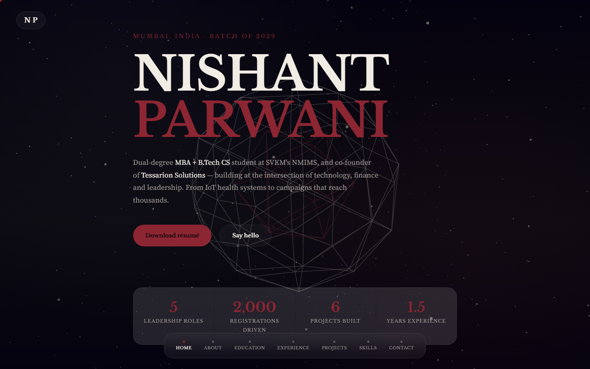

<div align="center">

# ✦ nishantparwani.com

### My corner of the internet — one file, a 3D starfield, zero frameworks

**[nishantparwani.com](https://nishantparwani.com)**




</div>

---

## What's inside

- **A living hero:** a wireframe polyhedron rotating in a drifting starfield, drawn with **three.js** behind the type.
- **Everything in one place:** about, education, experience, projects, skills and contact, with a floating section nav.
- **One file:** the whole site is `index.html` — HTML, CSS and JavaScript together; no build, no bundler, no framework.
- **Phone-first:** the same page reflows to a single column on small screens.

| Desktop | Phone |
|---|---|
|  |  |

## Run it locally

```bash
git clone https://github.com/nishantparwani/nishantparwani.github.io
# then open index.html in any browser
```

Push to `main` and GitHub Pages publishes it; `CNAME` points the custom domain at it.

## Use it as a template

Fork it, change the text in `index.html`, swap the colours in the CSS variables at the top, and update `CNAME`
(or delete it to use `<you>.github.io`). A star ⭐ is appreciated if it helps.
